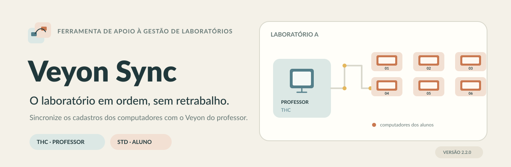

  
  <h2>Gestão dos computadores do laboratório, sem retrabalho.</h2>

  
  
   
  
  
  
  
  

> [!IMPORTANT]
> **Para instalar, use um pacote da página Releases.** O botão **Code → Download ZIP** baixa o código-fonte para desenvolvedores, não o instalador. A primeira Release oficial com o pacote completo será publicada após a validação do build e da assinatura no Windows do mantenedor.

## Visão geral

O **Veyon Sync** ajuda a manter o cadastro dos computadores de laboratórios escolares atualizado no [Veyon](https://veyon.io/).

Os computadores dos alunos enviam suas informações ao computador do professor. O responsável acompanha o inventário, revisa as alterações e decide quando integrá-las ao Veyon.

<table>
  <tr>
    <td width="50%" valign="top">
      <h3>THC · Professor</h3>
      
Centraliza os computadores do laboratório.

      <ul><li>Inventário e histórico</li><li>Mapa do laboratório</li><li>Prévia e integração com o Veyon</li><li>Backups e restauração</li><li>Consulta de atualizações pelo GitHub</li></ul>
    </td>
    <td width="50%" valign="top">
      <h3>STD · Aluno</h3>
      
Identifica o computador e conversa com o professor.

      <ul><li>Coleta de nome, usuário, IP e MAC</li><li>Envio automático ou manual</li><li>Credenciamento por código temporário</li><li>Fila persistente e novas tentativas</li><li>Atualizações distribuídas pelo THC</li></ul>
    </td>
  </tr>
</table>

## Painel do projeto

<table>
  <tr>
    <td align="center" width="25%"><strong>PRODUTO</strong> </td>
    <td align="center" width="25%"><strong>PLATAFORMA</strong> </td>
    <td align="center" width="25%"><strong>ATUALIZAÇÃO</strong> </td>
    <td align="center" width="25%"><strong>ALUNOS</strong> </td>
  </tr>
</table>

## Downloads oficiais

  <h3>Primeira instalação</h3>
  
  
<strong>VeyonSync-Instalacao-win-x64.zip</strong>

  
THC + STD + menu de instalação + tutorial offline.

  
<a href="docs/GUIA-INSTALACAO.md">Ler o guia de instalação antes de começar</a>

### O que existe em cada download?

| Arquivo | Para quem | O que contém |
|---|---|---|
| <code>VeyonSync-Instalacao-win-x64.zip</code> | Nova instalação | Pacote completo com professor, aluno e tutorial |
| <code>VeyonSync-THC-x.y.z-win-x64.vsupd</code> | Atualização do professor | Pacote assinado exclusivo do THC |
| <code>VeyonSync-STD-x.y.z-win-x64.vsupd</code> | Atualização dos alunos | Pacote assinado exclusivo do STD |
| <code>SHA256SUMS.txt</code> | Conferência | Hashes dos arquivos publicados |

> [!NOTE]
> O instalador completo é preparado junto com os pacotes de atualização e anexado à mesma GitHub Release. Assim, a primeira instalação e o atualizador usam artefatos da mesma versão.

## Como funciona

~~~mermaid
flowchart LR
    subgraph LAB["Computadores dos alunos"]
        S1["STD · PC 01"]
        S2["STD · PC 02"]
        S3["STD · PC ..."]
    end
    subgraph PROF["Computador do professor"]
        T["THC · serviço e interface"]
        DB[("Inventário e histórico")]
        CLI["veyon-cli"]
        VM["Veyon"]
        GH["GitHub Releases"]
    end
    S1 -->|HTTPS| T
    S2 -->|HTTPS| T
    S3 -->|HTTPS| T
    T --> DB
    T -->|Prévia e aplicação| CLI
    CLI --> VM
    GH -->|Atualização THC e pacote STD| T
    T -->|Distribuição na rede| S1
    T -->|Distribuição na rede| S2
~~~

1. **STD · Aluno:** coleta os dados do computador e envia as informações ao professor.
2. **THC · Professor:** recebe e valida os dados, mantém o inventário e registra o histórico.
3. **Integração com o Veyon:** o administrador analisa a prévia e confirma a aplicação. O processo cria um backup antes de alterar o diretório do Veyon.

## Instalação rápida

1. Abra [Releases](https://github.com/Rgc166/VeyonSync/releases).
2. Baixe <code>VeyonSync-Instalacao-win-x64.zip</code> da versão estável.
3. Extraia o ZIP em uma pasta local ou pendrive.
4. Execute <code>INICIAR.bat</code> como administrador.
5. No computador do professor, escolha **[1] Instalar professor**.
6. Nos computadores dos alunos, escolha **[2] Instalar aluno**.
7. Gere o arquivo de ligação no THC, credencie cada STD e confira a prévia de integração com o Veyon.

Os computadores do laboratório não precisam do .NET SDK. Ele é necessário apenas no computador utilizado para compilar o projeto.

**Guia completo:** [Instalação passo a passo](docs/GUIA-INSTALACAO.md).

## Atualizações pelo GitHub

O fluxo foi pensado para uma rede escolar:

| THC · Professor | STD · Aluno |
|---|---|
| Consulta as GitHub Releases | Não acessa o GitHub |
| Busca e instala sua própria atualização após confirmação | Recebe atualizações distribuídas pelo THC |
| Baixa o pacote assinado do STD | Também pode ser atualizado por arquivo |

A busca automática, quando habilitada, apenas avisa que existe uma versão disponível. A instalação depende de uma ação do administrador.

**Guia:** [Como atualizar o Veyon Sync](docs/GUIA-ATUALIZACAO.md).

## Segurança

- Comunicação entre alunos e professor por HTTPS com certificado do professor fixado no cliente.
- Código de credenciamento temporário, de uso único e com validade limitada.
- Comunicação entre interface e serviço por Named Pipes com acesso restrito a administradores.
- Integração com o Veyon pelo <code>veyon-cli</code>; o projeto não utiliza <code>networkobjects clear</code>.
- Pacotes de atualização assinados com ECDSA P-256 e conferidos antes da instalação.
- Chave privada do publicador mantida fora do repositório, em <code>%USERPROFILE%\.veyonsync-release</code>.

O STD envia informações necessárias à identificação do computador, como nome da máquina, usuário, IP e MAC. Utilize a ferramenta somente em equipamentos e redes que você tenha autorização para administrar.

## Documentação

  
<strong>Para quem vai instalar e administrar</strong>

  - [Guia de instalação](docs/GUIA-INSTALACAO.md)
  - [Guia de atualização pelo GitHub](docs/GUIA-ATUALIZACAO.md)
  - [Tutorial detalhado offline](docs/TUTORIAL.txt)
  - [Sistema de atualizações e compatibilidade](docs/ATUALIZACOES.txt)

  
<strong>Para desenvolvedores e mantenedores</strong>

  - [Publicação e distribuição](docs/DISTRIBUICAO.md)
  - [Orientações para trabalhar com o GitHub](docs/GITHUB.md)
  - [Mudanças da versão 2.2](docs/MUDANCAS-2.2.txt)

## Estrutura técnica

~~~text
Shared/        Modelos, TLS, IPC, assinatura e componentes comuns
Desktop/       Tema e componentes WPF compartilhados
Teacher/       Serviço do professor, SQLite e integração Veyon
TeacherApp/    Interface WPF do professor (THC)
Student/       Serviço do aluno, coleta, pareamento e envio
StudentApp/    Interface WPF do aluno (STD)
scripts/       Compilação, instalação, atualização e publicação
pendrive/      Menu e arquivos preparados para instalação
recuperacao/   Verificação e restauração manual
assets/        Recursos visuais, chave pública e repositório padrão
tests/         Testes automatizados (xUnit)
tools/         Ferramentas de geração e validação dos pacotes
docs/          Guias de uso, manutenção e histórico
.github/       Integração contínua no Windows
~~~

### Tecnologias

C# · .NET 10 · WPF · ASP.NET Core · SQLite · PowerShell · Veyon

### Limitações conhecidas

- A disponibilidade no Veyon Master não é medida pelo STD; aparece como não verificada.
- Trocas de posição entre máquinas no mesmo lote podem exigir ajuste manual de conflitos no Veyon.
- O mapa visual do laboratório não reorganiza a disposição mostrada pelo Veyon Master.
- O atualizador por GitHub Releases exige repositório público nesta versão.
- A interface foi planejada para telas a partir de 1366 × 768; valide nos monitores usados no laboratório.

### Licença

Este repositório ainda não possui uma licença de código aberto. Até que uma licença seja definida, todos os direitos permanecem reservados ao autor. A publicação do código não concede automaticamente permissão de reutilização ou redistribuição.
