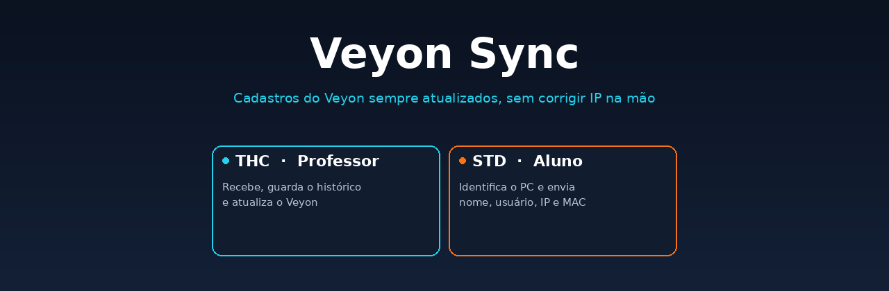
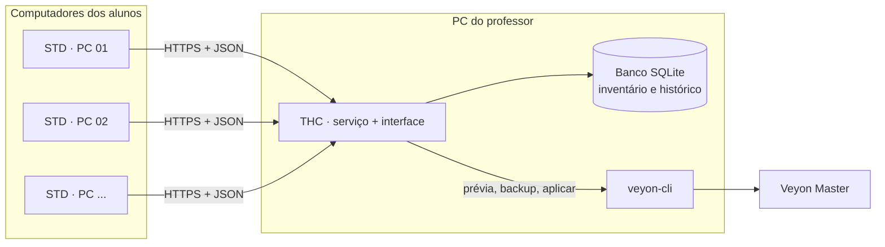

<div align="center">




**[Como funciona](#-como-funciona) · [Recursos](#-recursos) · [Instalação](#-instalação-rápida) · [Atualizações](#-atualizações) · [Segurança](#-segurança) · [Limitações](#-limitações)**

</div>

> [!WARNING]
> Projeto em fase de testes. O código compila e os testes automatizados passam, mas a integração com o **Veyon real** e o uso nos laboratórios ainda precisam ser validados. Faça sempre a **prévia** e um lote pequeno antes de integrar tudo.

## 🎯 O problema

Em laboratórios de escola os IPs mudam com frequência, e cada mudança obriga a corrigir os cadastros à mão no Veyon Configurator.

O **Veyon Sync** faz isso sozinho: cada computador do aluno informa seus dados ao professor do próprio laboratório, e o professor mantém o diretório do Veyon atualizado pelo `veyon-cli` oficial.

## ⚙️ Como funciona



1. O **STD** (aluno) coleta nome, usuário, IP, MAC e posição e envia ao professor.
2. O **THC** (professor) valida, salva e só depois confirma o recebimento.
3. O administrador revisa a **prévia** e aplica no Veyon. O THC faz backup antes e confere o resultado depois.

## ✨ Recursos

| 👨‍🏫 THC — Professor | 🧑‍🎓 STD — Aluno |
|---|---|
| Inventário e histórico de cada computador | Funciona antes do login e com a janela fechada |
| Prévia antes de qualquer mudança no Veyon | Envia ao iniciar, ao entrar usuário, ao mudar o IP e a cada 60 s |
| Backup do Veyon antes de aplicar; restauração por laboratório | Fila persistente com novas tentativas e espera crescente |
| Mapa do laboratório (arrastar e soltar) | Modo manual: sem envios automáticos |
| Exporta CSV, TXT, PDF e DOCX (sem precisar do Word) | Interface simples em português |
| Vários laboratórios: um professor pode integrar os outros | Atualiza pelo professor, sem acessar o GitHub |

## 🖼️ Telas

<!--
Depois de tirar as capturas de tela, salve em docs/images/ e apague esta linha e a de fechamento:
<p align="center">
  
  
</p>
-->

*Capturas de tela serão adicionadas aqui.*

## 🚀 Instalação rápida

**No PC de desenvolvimento** (precisa do [.NET SDK 10](https://dotnet.microsoft.com/download/dotnet/10.0) x64):

1. Extraia o projeto e dê dois cliques em `GERAR_ZIPS_UPDATE.bat`. Ele compila, roda os testes e monta o instalador em `dist\Pendrive\VeyonSync`.
2. Copie essa pasta para o pendrive.

**Em cada PC dos laboratórios:** `INICIAR.bat` (pede administrador sozinho)

| Opção | Para quê |
|---|---|
| `[1]` Instalar professor | Uma vez por laboratório |
| `[2]` Instalar aluno | Em cada PC de aluno |
| `[3]` Aplicar atualização | Atualiza preservando banco, histórico e pareamentos |

Depois: no THC, **Credenciamento → Gerar arquivo de ligação**; no STD, importe o arquivo, informe o número do PC e o código de 8 dígitos.

> [!TIP]
> O tutorial completo, em português, está em [`docs/TUTORIAL.txt`](docs/TUTORIAL.txt).

Os laboratórios **não precisam** do .NET instalado: os pacotes já incluem o runtime.

## 🔄 Atualizações

- Pacotes `.vsupd` assinados pelo publicador (ECDSA P-256), por **GitHub Releases** ou por **arquivo**.
- O THC baixa e distribui o pacote do aluno pela rede; o aluno não acessa o GitHub.
- Se a nova versão não subir em 90 s, o atualizador volta sozinho para a anterior.
- Kit de recuperação manual em [`recuperacao/`](recuperacao/).

Detalhes em [`docs/ATUALIZACOES.txt`](docs/ATUALIZACOES.txt) e [`docs/MUDANCAS-2.2.txt`](docs/MUDANCAS-2.2.txt).

## 🔒 Segurança

- TLS com **certificado do professor fixado**; a validação não é desativada nem há raiz instalada no Windows.
- Código de credenciamento de 8 dígitos, 15 minutos, uso único, com limite de tentativas.
- Comunicação entre interface e serviço por Named Pipe restrita a administradores.
- O Veyon só é alterado por comandos documentados do `veyon-cli`; `networkobjects clear` nunca é usado e cadastros não gerenciados são preservados.
- Chave privada de publicação fica fora do repositório (`%USERPROFILE%\.veyonsync-release`).

## ⚠️ Limitações

- A disponibilidade no Veyon Master **não é medida** (aparece como "não verificada").
- Trocar duas máquinas de posição entre si no mesmo lote aparece como conflito no Veyon.
- O mapa do laboratório não reorganiza o Veyon Master.
- Repositório privado de atualizações não é suportado.

<details>
<summary><b>📁 Estrutura do projeto</b></summary>

```text
Shared/       modelos, arquivo de ligação, TLS, IPC, assinatura, exportadores
Teacher/      serviço do professor (ASP.NET Core + SQLite + veyon-cli)
Student/      serviço do aluno (coleta, fila, envio, pareamento)
Desktop/      tema e componentes WPF compartilhados
TeacherApp/   interface do professor (WPF)
StudentApp/   interface do aluno (WPF)
tests/        testes automatizados (xUnit)
tools/        ferramenta de geração e assinatura de pacotes
scripts/      build, instalação, atualização e remoção
pendrive/     INICIAR.bat e textos das pastas do pendrive
recuperacao/  verificação antes de atualizar e restauração manual
docs/         tutorial, atualizações e histórico de mudanças
```

</details>

## 🧱 Tecnologias

C# · .NET 10 · WPF · ASP.NET Core · SQLite · PowerShell · [Veyon](https://veyon.io/)

## 📄 Licença

Ainda não definida: sem licença, todos os direitos ficam reservados ao autor.
