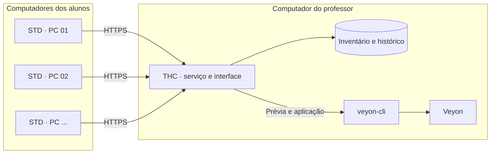

<div align="center">
  

  **Windows x64 · C# · .NET 10 · WPF · Veyon**

  [Visão geral](#visão-geral) · [Como funciona](#como-funciona) · [Instalação](#instalação) · [Atualizações](#atualizações) · [Segurança](#segurança) · [Documentação](#documentação)
</div>

> [!WARNING]
> **Em fase de validação.** A compilação e os testes automatizados fazem parte do processo de build, mas isso não substitui a validação com o Veyon instalado e em uso real no laboratório. Antes de integrar todos os computadores, teste em um ambiente pequeno e confira a prévia.

## Visão geral

O **Veyon Sync** automatiza a manutenção dos cadastros de computadores usados pelo [Veyon](https://veyon.io/) em laboratórios escolares.

O serviço instalado nos computadores dos alunos identifica os dados necessários para o cadastro e os envia ao computador do professor. No THC, o responsável confere o inventário, revisa o que será alterado e decide quando aplicar as mudanças ao Veyon.

A proposta é reduzir correções manuais quando um computador muda de endereço IP, nome ou posição no laboratório, mantendo o administrador no controle da integração.

## Como funciona



1. **STD · Aluno:** coleta os dados do computador e envia as informações ao professor. O modo de envio pode ser automático ou manual.
2. **THC · Professor:** recebe e valida os dados, mantém o inventário e registra o histórico.
3. **Integração com o Veyon:** o administrador analisa a prévia e confirma a aplicação. O processo cria um backup antes de alterar o diretório do Veyon.

## O que oferece

| THC · Professor | STD · Aluno |
|---|---|
| Inventário e histórico dos computadores | Serviço em segundo plano do Windows |
| Prévia de alterações antes de integrar ao Veyon | Envio automático ou manual, conforme a configuração |
| Backup e opção de restauração da configuração do Veyon | Fila persistente e novas tentativas de envio |
| Mapa do laboratório com organização visual dos PCs | Credenciamento por arquivo de ligação e código temporário |
| Gestão central de mais de um laboratório | Atualização distribuída pelo professor |
| Exportação de relatórios e registros | Interface de acompanhamento em português |

## Instalação

A instalação é feita a partir de um pacote preparado em um computador de desenvolvimento e copiado para um pendrive. Os computadores do laboratório recebem os aplicativos já publicados com o runtime incluído; não precisam ter o .NET SDK instalado.

### 1. Preparar o pacote

No computador usado para compilar:

- Windows x64;
- [.NET SDK 10 (x64)](https://dotnet.microsoft.com/download/dotnet/10.0);
- cópia local deste repositório.

Na pasta principal do projeto, execute:

```powershell
.\BUILD.bat
```

O script compila os serviços e as interfaces, executa os testes automatizados e prepara a pasta:

```text
dist\Pendrive\VeyonSync\
```

Se a compilação ou os testes falharem, o pacote não deve ser considerado pronto. Consulte **build-log.txt** para localizar o erro.

### 2. Instalar no laboratório

Copie a pasta **VeyonSync** gerada para o pendrive. Em cada computador, execute **INICIAR.bat**:

| Opção | Onde usar | Finalidade |
|---|---|---|
| **1 · Instalar professor** | Um computador por laboratório | Instala o THC e o serviço do professor |
| **2 · Instalar aluno** | Cada computador de aluno | Instala o STD e o serviço do aluno |
| **3 · Aplicar atualização** | Computador já instalado | Atualiza o programa preservando os dados |

O menu solicita a elevação de administrador quando necessário. Depois de instalar o professor, gere o arquivo de ligação no THC. Em cada aluno, importe esse arquivo, informe o número do PC e valide o código temporário gerado pelo professor.

O procedimento completo está em [docs/TUTORIAL.txt](docs/TUTORIAL.txt).

## Atualizações

O projeto separa a preparação do instalador inicial da geração de versões de atualização.

### Publicar uma nova versão

Execute **PUBLICAR_UPDATE.bat** no computador de desenvolvimento. O processo compila, roda os testes, gera os pacotes THC e STD e assina os arquivos de atualização. É necessário ter o .NET SDK 10 e a chave privada do publicador, armazenada fora do repositório em **%USERPROFILE%\.veyonsync-release**.

Para publicar no GitHub Releases, também é necessário instalar a [GitHub CLI](https://cli.github.com), autenticar com **gh auth login** e confirmar a publicação no próprio script.

### Gerar pacotes para transferência por arquivo

Execute **GERAR_ZIPS_UPDATE.bat** para preparar os arquivos de entrega em **dist\Entrega\\<versão>\\**:

- ZIP de atualização do THC, destinado ao computador do professor;
- ZIP de atualização do STD, destinado aos computadores dos alunos;
- ZIP de recuperação, com os recursos para verificação e restauração manual.

Os pacotes de atualização são assinados e verificados antes da entrega. Atualize primeiro o professor e depois os alunos.

Consulte [docs/ATUALIZACOES.txt](docs/ATUALIZACOES.txt) para o fluxo completo e as condições de compatibilidade.

## Segurança

- A comunicação entre os alunos e o professor usa HTTPS com certificado do professor fixado no cliente.
- O credenciamento utiliza um código temporário de oito dígitos, com validade limitada e uso único.
- A comunicação entre a interface e o serviço do professor usa Named Pipes com acesso restrito a administradores.
- A integração com o Veyon é feita pelo **veyon-cli**; o projeto não usa o comando **networkobjects clear** e preserva os cadastros que não gerencia.
- Os pacotes de atualização são assinados com ECDSA P-256 e verificados antes da instalação.
- A chave privada do publicador não deve ser colocada no repositório. A chave pública em **assets/release-public-key.txt** pode ser versionada.

O STD envia ao professor informações de identificação e rede do computador, como nome da máquina, usuário, IP e MAC. Instale e utilize o sistema somente em laboratórios nos quais você tenha autorização para administrar esses dados.

## Limitações conhecidas

- O estado de disponibilidade no Veyon Master não é medido pelo STD; essa informação aparece como **não verificada**.
- A troca de posição entre duas máquinas no mesmo lote pode ser sinalizada como conflito pelo Veyon e exigir ajuste manual.
- O mapa visual do laboratório não reorganiza a disposição exibida pelo Veyon Master.
- A atualização pelo GitHub Releases requer um repositório público nesta versão; repositórios privados não são suportados pelo atualizador.
- A compatibilidade visual foi planejada para telas a partir de 1366 × 768, mas deve ser conferida nos monitores usados no laboratório.

## Estrutura do projeto

```text
Shared/        Modelos, TLS, IPC, assinatura e componentes comuns
Teacher/       Serviço do professor, banco SQLite e integração com o Veyon
Student/       Serviço do aluno, coleta, pareamento e envio
Desktop/       Tema e componentes WPF compartilhados
TeacherApp/    Interface WPF do professor (THC)
StudentApp/    Interface WPF do aluno (STD)
scripts/       Compilação, instalação, atualização e publicação
pendrive/      Menu e arquivos preparados para o pendrive
recuperacao/   Verificação e restauração manual
assets/        Recursos visuais e chave pública de atualização
tests/         Testes automatizados (xUnit)
tools/         Ferramentas de geração e validação dos pacotes
docs/          Tutorial, atualizações e histórico de mudanças
```

## Documentação

- [Tutorial de instalação e uso](docs/TUTORIAL.txt)
- [Sistema de atualizações](docs/ATUALIZACOES.txt)
- [Mudanças da versão 2.2](docs/MUDANCAS-2.2.txt)
- [Orientações para trabalhar com o GitHub](docs/GITHUB.md)

## Tecnologias

C# · .NET 10 · WPF · ASP.NET Core · SQLite · PowerShell · Veyon

## Licença

Este repositório ainda não possui uma licença de código aberto. Até que uma licença seja adicionada, todos os direitos permanecem reservados ao autor; a publicação do código não concede automaticamente permissão para reutilização ou redistribuição.
